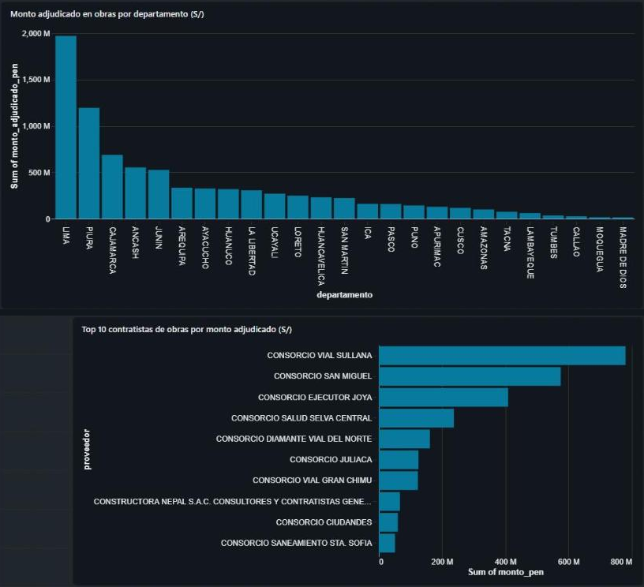
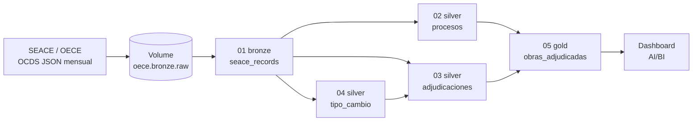

# Contrataciones públicas del Perú en Databricks (SEACE / OECE)

Pipeline de datos end-to-end en **Databricks** que toma los datos abiertos de contrataciones públicas del Perú (SEACE, publicados por el OECE en formato **OCDS JSON**), los procesa con arquitectura **medallion (bronze → silver → gold)** y los expone en un **dashboard de obras adjudicadas**.

## Qué responde

- ¿Cuánto se adjudica en obras públicas por departamento?
- ¿Qué contratistas concentran los mayores montos adjudicados?
- ¿Cuántos procesos se publican por categoría (obras, bienes, servicios)?

## Arquitectura

Todo vive en **Unity Catalog** bajo el catálogo `oece`, con un esquema por capa. El job `pipeline_seace` orquesta los cinco notebooks en orden.

| Capa | Tabla | Qué hace |
|---|---|---|
| Bronze | `oece.bronze.seace_records` | Lee todos los JSON mensuales del volume, aplana el arreglo `records` y guarda el `compiledRelease` tal cual, con columnas de auditoría (`_archivo_origen`, `periodo`, `_fecha_ingesta`). |
| Silver | `oece.silver.procesos` | Un registro por proceso (`ocid`), quedándose con la versión más reciente. Extrae entidad, departamento, categoría, tipo de procedimiento y monto referencial. |
| Silver | `oece.silver.tipo_cambio` | Deriva un tipo de cambio mensual por moneda a partir de los propios datos (mediana de `amount_PEN / amount`), sin depender de una API externa. |
| Silver | `oece.silver.adjudicaciones` | Un registro por adjudicación y proveedor. Limpia el RUC y convierte todos los montos a soles con el tipo de cambio del mes (o el promedio de la moneda si falta el mes). |
| Gold | `oece.gold.obras_adjudicadas` | Une procesos y adjudicaciones, filtra solo **obras** y deja una tabla lista para BI. |

## Decisiones de diseño

- **Bronze sin transformar.** El JSON se guarda tal como llega para poder reprocesar silver y gold sin volver a descargar.
- **Deduplicación por versión.** OCDS publica varias versiones de un mismo proceso; en silver se toma la más reciente por `ocid` con una ventana (`row_number`).
- **Montos comparables.** Hay adjudicaciones en USD, EUR y GBP; todas se llevan a soles para poder sumarlas.
- **Recarga idempotente.** Cada capa se escribe en modo `overwrite`, así el job puede volver a ejecutarse sin duplicar datos.

## Datos (agosto – noviembre 2026)

- 21,631 procesos: 8,911 de servicios, 8,714 de bienes y 4,006 de obras.
- 13,161 adjudicaciones, de las cuales 2,359 son de obras.
- Lima (S/ 1,969 M) y Piura (S/ 1,194 M) encabezan el monto adjudicado en obras.

## Stack

Databricks (Free Edition) · PySpark · Delta Lake · Unity Catalog (volumes y esquemas por capa) · Jobs · AI/BI Dashboards · Git folders

## Cómo reproducirlo

1. Descarga los archivos mensuales `*_seace_v3.json` desde el portal de Contrataciones Abiertas del OECE.
2. Crea el catálogo `oece` con los esquemas `bronze`, `silver` y `gold`, y un volume `oece.bronze.raw`.
3. Sube los JSON al volume.
4. Ejecuta los notebooks en este orden: `01`, `02`, `04`, `03`, `05` (`03` necesita el tipo de cambio que genera `04`). También puedes crear un job que los encadene así.

## Autor

Joseph Guadalupe — Data Engineer · [Portafolio](https://josephh123.github.io/PortafolioData/)
